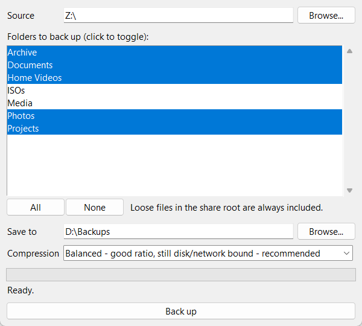

# TrueNAS Backup

Single executable for backing up a TrueNAS server to Windows or Linux.

Point it at your share, choose where the backup goes, and press **Back up**.
You get one compressed `.tar.zst` file containing everything, exactly as it was.



## Download

Grab the latest build from [Releases](../../releases/latest).

| Platform | File |
|----------|------|
| Windows  | `TrueNAS-Backup.exe` |
| Linux    | `TrueNAS-Backup` (run `chmod +x TrueNAS-Backup` once) |

No install, no Python, nothing to set up on the NAS.

## Usage

1. **Source**: your mounted TrueNAS share, e.g. `Z:\` or `/mnt/truenas`
2. **Folders**: tick the folders to include. Loose files in the share root are always included.
3. **Save to**: any folder or drive, e.g. `D:\Backups` or `/home/you/backups`
4. **Compression**: pick a preset and press **Back up**

Your choices are saved next to the executable for next time.

## Compression presets

| Preset | Speed | Size | RAM |
|--------|-------|------|-----|
| Fastest | Fastest | Largest | Low |
| **Balanced** (recommended) | Fast | Small | Low |
| Smaller | ~2x slower | ~5-8% smaller | ~1 GiB per core |
| Smallest | Several times slower | Smallest | ~2 GiB per core |

Every preset is lossless. They only trade speed and memory for file size.

## Features

- **Live backup**: reads the share as it is right now, no snapshots needed
- **Safe writes**: the archive is written as `.partial` and only renamed when finished, so a crashed or cancelled run never looks like a good backup
- **Never stops on bad files**: unreadable files are skipped and listed in a `.skipped.log` next to the archive
- **Fast**: uses every CPU core, with long-range matching for better compression on big files
- **Long paths**: handles Windows paths over 260 characters
- **Cancel any time**: nothing half-written is left behind

## Restore

**Windows:** open the archive with [7-Zip](https://www.7-zip.org/) (24.09 or newer).

**Linux / macOS:**
```sh
tar --zstd -xf truenas-full-2026-10-06.tar.zst -C /restore/here
```

Archives made with **Smaller** or **Smallest** need zstd's long mode to open:
```sh
tar --use-compress-program="zstd -d --long=31" -xf truenas-full-2026-10-06.tar.zst -C /restore/here
```

Or use the script, which opens every preset:
```sh
python backup_server.py --restore truenas-full-2026-10-06.tar.zst /restore/here
```

## Command line

`backup_server.py` is the same backup with an interactive menu and extra options,
which makes it a good fit for scheduled jobs.

```sh
pip install -r requirements.txt

python backup_server.py                                  # interactive menu
python backup_server.py --run --source Z:\ --dest D:\Backups
python backup_server.py --run --preset smallest --keep 6 # keep the 6 newest backups
python backup_server.py --run --exclude movies --dry-run # measure only, write nothing
```

Run `python backup_server.py --help` for every option.

## Build from source

```sh
pip install -r requirements.txt pyinstaller
pyinstaller --onefile --windowed --name TrueNAS-Backup backup_gui.py
```

The executable ends up in `dist/`. Releases are built automatically by GitHub Actions when a `v*` tag is pushed.

## License

[MIT](LICENSE)
